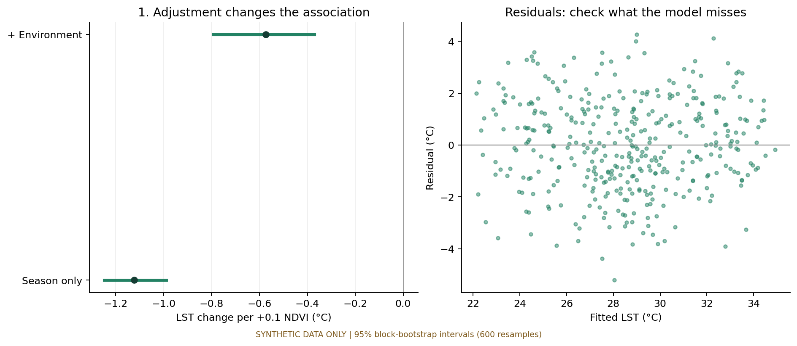
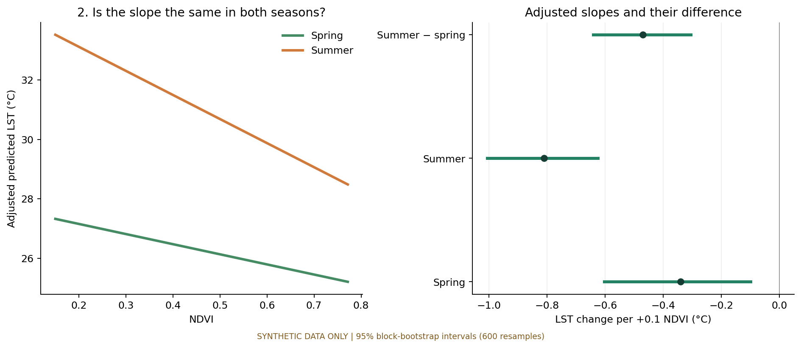
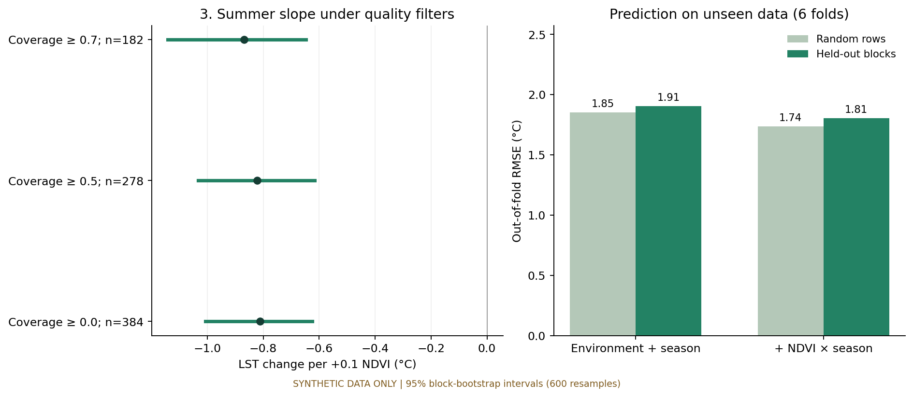

> **교육용 합성자료에 기반한 학술 보고서 예시.** 본문은 실제 도시·Landsat 관측 결과를 제시하지 않는다. 기본 탐색용 36개 표본과 세부목적 분석용 384행은 서로 다른 합성자료이다. 연구 질문을 학술적 목적으로 구체화하는 과정을 보여주기 위해 일상적 질문과 정식 목적 진술을 함께 제시하였다.

### 초록 {#abstract}

본 연구의 목적은 합성자료에서 녹지 지표와 지표면 온도의 관계가 환경조건 보정 및 계절 구분에 따라 어떻게 달라지는지 추정하고, 추정 결과의 품질 기준 민감도와 미관측 공간 블록에 대한 예측 성능을 평가하는 데 있다. 기본 탐색에는 36개 가상 표본을, 세부목적 분석에는 24개 블록에 속한 192지점의 두 계절 자료 384행을 사용하였다. 환경조건 보정 회귀, NDVI와 계절의 교호작용, 600회 블록 bootstrap 및 6-fold 블록 교차검증을 적용하였다. NDVI 0.1 증가당 계수는 계절만 보정한 모형에서 −1.12°C, 환경조건까지 보정한 모형에서 −0.57°C였다. 계절별 계수는 봄 −0.34°C, 여름 −0.81°C로 나타났다. 세 품질 기준에서 여름 계수의 음의 방향은 유지되었으며, NDVI 및 계절 교호작용을 추가했을 때 블록 교차검증 RMSE는 1.91°C에서 1.81°C로 감소하였다. 이 결과는 설정된 자료 생성 구조 아래에서 조건부 연관성, 계절별 차이, 예측 성능을 구분하여 평가할 필요성을 예시한다. 실제 녹지의 냉각 효과나 타 지역에 대한 적용 가능성을 입증하는 실증 근거는 아니다.

**주제어:** NDVI, 지표면 온도, 환경조건 보정, 계절 교호작용, 공간 블록 교차검증, 합성자료

## 1. 연구 배경 {#background}

지표면 온도(LST)는 지표의 복사 흡수·방출과 열 저장, 대기와의 열 교환이 결합된 지표면 에너지 수지의 상태를 나타낸다. 도로·건물·토양·식생의 표면 온도 차이는 도시 내부의 열환경이 공간적으로 불균등하게 형성되는 과정을 이해하는 데 중요하다. 위성 열적외선 관측은 이러한 차이를 넓은 영역에서 파악할 수 있으므로, 고온 지표의 분포와 토지피복에 따른 열환경 특성을 진단하는 근거가 된다. 다만 LST는 지표의 온도이므로, 그 차이를 기온이나 인체의 열 노출 차이와 동일하게 해석해서는 안 된다. [Voogt and Oke (2003)](https://doi.org/10.1016/S0034-4257(03)00079-8).

녹지는 지표면 에너지의 배분을 변화시킬 수 있다는 점에서 도시 열환경 완화의 중요한 검토 대상이다. 수목의 수관은 하부 지표에 도달하는 일사를 차단하고, 식생과 토양의 증발산은 에너지의 일부를 물의 기화에 소비하여 표면 가열을 완화한다. 따라서 녹지와 LST의 관계를 정량화하는 일은 녹지가 존재하는 위치를 파악하는 데서 나아가, **어떤 조건에서 녹지가 낮은 지표면 온도와 연관되는지 평가하고 녹지의 배치·관리를 검토할 근거를 마련한다는 의미**가 있다. 유럽 293개 도시를 분석한 연구에서도 수목 지역과 시가화 지역의 LST 차이는 지역과 계절에 따라 달랐으며, 수목이 있는 녹지와 없는 녹지의 차이도 확인되었다. [Schwaab et al. (2021)](https://doi.org/10.1038/s41467-021-26768-w).

이러한 물리적 기작이 존재하더라도, 녹지 지표가 높은 곳의 낮은 LST를 곧바로 녹지의 인과적 효과로 해석할 수는 없다. 녹지의 공간 분포와 함께 달라지는 환경조건을 고려해야 하며, 증발산과 차광의 기여도 수분 조건·식생 특성·계절에 따라 달라질 수 있다. 또한 맑은 날에 주로 확보되는 위성 LST의 특성상 관측 가능한 표본이 전체 조건을 대표하는지도 검토해야 한다. 따라서 녹지–LST 관계를 열환경 관리의 근거로 활용하려면 단순한 음의 상관을 제시하는 데 그치지 않고, **환경조건 보정 후의 관계, 계절별 차이, 자료 선택 및 평가 지역 변경에 대한 안정성**을 구분하여 평가할 필요가 있다. [Schwaab et al. (2021)](https://doi.org/10.1038/s41467-021-26768-w).

본 연구는 이러한 문제의식에 따라 NDVI를 녹지 관련 지표로 사용하고, 환경조건 보정·계절별 이질성·공간 예측 검증을 연결한 분석을 수행한다. 다만 합성자료를 이용한 교육용 사례이므로, 그 목적은 실제 녹지의 냉각 효과를 입증하는 데 있지 않고 위의 연구 질문을 검토하는 분석 절차를 제시하는 데 있다.

## 2. 연구 질문 {#question}

연구 배경의 분석 문제를 다음 세 질문으로 구체화하였다. 일상적 질문은 문제의식을 표현하고, 학술적 연구 질문은 비교 대상과 조건을 명시한다. 질문 1–3은 다음 절의 세부목적 1–3에 각각 대응한다.

### 2.1 연구 질문 1

> **일상적 질문:** “녹지가 많은 곳이 더 시원한 건, 고도가 높거나 포장된 면적이 적어서 그런 것 아닐까?”

**학술적 연구 질문.** 계절만 고려한 NDVI–LST 연관성은 고도·불투수면 비율·해안 거리를 추가로 보정한 이후 어느 정도 변화하는가?

### 2.2 연구 질문 2

> **일상적 질문:** “녹지와 온도의 관계가 봄에도, 여름에도 똑같을까?”

**학술적 연구 질문.** 환경조건을 보정한 NDVI–LST 기울기는 봄과 여름 사이에 차이가 있는가?

### 2.3 연구 질문 3

> **일상적 질문:** “자료를 더 엄격하게 골라도 결과가 같을까? 다른 지역에서도 온도를 잘 맞힐까?”

**학술적 연구 질문.** 계절별 추정치는 유효 관측 비율 기준에 얼마나 민감하며, NDVI와 계절 교호작용의 추가는 학습에 포함되지 않은 공간 블록의 예측 오차를 얼마나 감소시키는가?

## 3. 연구 목적 {#objectives}

### 3.1 전체 연구목적

**본 연구는 합성자료에서 NDVI–LST 관계의 조건부 연관성과 계절별 이질성을 정량화하고, 자료 품질 기준에 대한 추정의 민감도 및 미관측 공간 블록에서의 예측 성능을 평가하는 것을 목적으로 한다.** 여기서 이질성은 계절에 따라 관계의 기울기가 달라지는 정도를 의미한다. 분석의 추론 대상은 설정된 합성자료와 모형이며, 녹지 조성이라는 개입의 인과효과는 포함하지 않는다.

이 목적을 달성하기 위해 세부목적을 순차적으로 구성하였다. 먼저 환경변수와 함께 나타나는 관계를 검토하여 단순한 연관성의 해석 범위를 좁힌다(세부목적 1). 다음으로 하나의 공통 기울기가 계절별 차이를 가리는지 평가한다(세부목적 2). 마지막으로 추정 결과가 표본 선택 조건에 얼마나 민감한지, 그리고 그 관계가 새로운 공간 집단의 예측에 얼마나 기여하는지 확인한다(세부목적 3). 세 목적은 각각 **조건부 관계의 추정 → 관계의 이질성 평가 → 결과의 안정성과 예측 성능 평가**에 대응한다.

### 3.2 세부목적 1 · 환경조건 보정에 따른 NDVI–LST 연관성의 변화 정량화

**연구 질문 1의 목적화.** 계절 보정 모형과 환경조건 추가 보정 모형의 NDVI 회귀계수를 비교하여, 환경조건 보정에 따른 조건부 연관성의 크기와 불확실성을 정량화한다.

**필요성 및 평가 지표.** 합성자료의 생성 과정에서 NDVI와 환경변수가 함께 변하므로, 계절만 보정한 계수를 녹지의 고유한 영향으로 해석할 수 없다. NDVI 0.1 증가당 계수와 블록 bootstrap 구간을 비교하여 다음 단계의 계절별 분석에 사용할 기준 모형을 설정한다.

### 3.3 세부목적 2 · NDVI–LST 연관성의 계절별 이질성 평가

**연구 질문 2의 목적화.** NDVI와 계절의 교호작용을 포함한 모형으로 봄·여름의 조건부 기울기와 두 기울기의 차이를 추정하여 계절별 이질성을 평가한다.

**필요성 및 평가 지표.** 세부목적 1의 공통 기울기 모형은 계절 간 동일한 관계를 가정한다. 이 가정을 재검토하지 않으면 전체 평균 관계가 계절별 특성을 가릴 수 있다. 봄·여름의 기울기 및 여름−봄 차이의 구간을 평가하고, 계절을 구분한 추정값을 후속 민감도 분석의 대상으로 삼는다.

### 3.4 세부목적 3 · 품질 기준 민감도 및 미관측 공간 블록의 예측 성능 평가

**연구 질문 3의 목적화.** 복수의 품질 기준에서 계절별 계수와 불확실성을 비교하고, 동일한 공간 블록 분할을 이용한 기준 모형과 확장 모형의 교차검증으로 NDVI의 추가 예측 기여를 평가한다.

**필요성 및 평가 지표.** 동일 표본에서 추정한 관계만으로는 자료 선택에 대한 민감도와 표본 밖 예측 성능을 판단할 수 없다. 품질 기준별 표본 수·기울기·추정 구간과 블록 교차검증 RMSE를 함께 제시하여, 관계 추정의 안정성과 예측상의 유용성을 구분한다.

## 4. 재료 {#materials}

## 4.1. 연구 대상 지역 및 분석 기간

본 연구의 대상 지역은 호주 남호주주(South Australia)에 위치한 캥거루섬이다. 캥거루섬은 2019년 말부터 2020년 초까지 대규모 산불이 발생한 지역으로, 산불 이전의 식생 상태와 이후 회복 과정을 비교하기에 적합하다고 판단하였다.

연구지역의 공간적 범위는 Google Earth Engine(GEE)에서 제공하는 FAO GAUL 2025의 2단계 행정경계 자료를 활용하여 설정하였다. 해당 자료에서 캥거루 섬에 해당하는 경계를 추출하였으며, GEE로 계산한 연구지역 면적은 약 4,400.366km²이다. 이후 수행한 산불 피해 분석과 식생 회복 분석에는 동일한 연구지역 경계를 적용하였다.

전체 분석 기간은 2019년부터 2025년까지이다. 산불 이전 상태는 2019년 2월 1일부터 4월 30일까지, 산불 직후 상태는 2020년 2월 7일부터 4월 30일까지를 기준으로 설정하였다. 실제 검색된 Sentinel-2 영상의 촬영일은 산불 이전 2019년 2월 1일~ 4월 30일, 산불 이후 2020년 2월 9일~ 4월 29일이었다.

2021년부터 2025년까지의 식생 변화는 매년 2월 1일부터 4월 30일까지의 영상으로 분석하였다. 매년 비슷한 계절을 선택하여 계절에 따른 식생 변화의 영향을 줄이고자 하였으며, 산불 전후의 관측 시기 차이가 분석에 미칠 수 있는 영향도 함께 고려하였다.

## 4.2. 위성 관측자료

본 연구의 주요 위성자료는 유럽연합 Copernicus 프로그램의 Sentinel-2 Level-2A 지표반사도(Surface Reflectance) 영상이다. GEE에서 사용한 데이터셋 ID는 `COPERNICUS/S2_SR_HARMONIZED`이다. 이 자료는 대기보정된 지표반사도 자료이며, 서로 다른 처리 시기의 영상값을 비교할 수 있도록 조정한 Harmonized 컬렉션을 사용하였다.

Sentinel-2에서 사용한 주요 밴드는 B2(청색), B3(녹색), B4(적색), B8(근적외선), B12(단파적외선)이다. B2, B3, B4, B8의 원래 공간해상도는 10m이고, B12는 20m이다. 구름과 구름 그림자 등을 구분하기 위한 SCL(Scene Classification Layer)은 20m 해상도를 가진다.

B2·B3·B4는 산불 전후 자연색 영상 제작에 활용하였으며, B8과 B12는 NBR 및 dNBR 계산에 사용하였다. 식생 상태를 나타내는 NDVI는 B8과 B4를 이용하여 계산하였다. NBR, dNBR, NDVI는 모두 반사도에서 계산되는 무차원 지수이다.

Sentinel-2의 지표반사도 밴드는 원래 반사도에 10,000을 곱한 값으로 제공된다. 본 연구에서는 자연색 영상 제작 시 0.0001의 배율을 적용하였으며, 정규화 지수는 두 밴드의 비율을 이용하여 계산하였다.

위성영상 확보량을 확인한 결과, 최초 설정한 3개월 분석 기간에서 2019년 90장, 2020년 90장의 영상 장면이 검색되었다. 이후 산불 전후 대표 영상 제작에 사용한 기간에서는 2019년 90장, 2020년 83장이 확인되었다. 이 수치는 캥거루섬과 공간적으로 겹치는 개별 위성영상 장면의 수이며, 독립적인 현장 관측지점 수를 의미하지 않는다.

## 4.3. 산불 범위 및 토지피복 보조자료

Sentinel-2의 산불 피해 분석 결과를 비교하고 산불 발생지역을 구분하기 위해 NASA의 MODIS MCD64A1 Version 6.1 자료를 사용하였다. GEE 데이터셋 ID는 `MODIS/061/MCD64A1`이며, 원래 공간해상도는 500m이다.

MCD64A1은 월별 산불 소실지역을 추정한 자료로, 본 연구에서는 `BurnDate` 밴드를 사용하였다. BurnDate는 연소가 탐지된 날짜를 연중 일수로 나타내며, 0은 연소가 탐지되지 않은 픽셀을 의미한다. 2019년 12월 1일부터 2020년 2월 29일까지의 자료에서 BurnDate가 0보다 큰 픽셀을 추출하고, 해당 기간의 연소 탐지지역을 하나의 공간 범위로 결합하였다.

이 자료는 Sentinel-2에서 계산한 dNBR 피해지역과 비교하는 데 사용하였으며, 식생 회복 분석의 공간적 범위를 설정하는 데에도 활용하였다. 다만 MODIS 산불 탐지지역은 위성자료로 추정한 결과이므로 실제 산불 경계와 완전히 일치한다고 볼 수는 없다.

산불 이전 토지피복을 구분하기 위해 Google과 World Resources Institute(WRI)의 Dynamic World V1 자료를 사용하였다. GEE 데이터셋 ID는 `GOOGLE/DYNAMICWORLD/V1`이며, 공간해상도는 10m이다.

Dynamic World는 수역, 산림, 초지, 농경지, 관목 등 총 9개 토지피복 유형을 구분하는 자료이다. 본 연구에서는 2019년 2~4월의 `label` 밴드를 사용하였으며, 여러 날짜에서 가장 자주 나타난 분류값을 대표 토지피복으로 설정하였다.

이후 산림을 나타내는 분류 코드 1(Trees)을 추출하여 산림지역의 피해 심각도별 NDVI 회복률을 별도로 분석하였다. 해당 자료는 위성영상으로 추정한 토지피복 분류 결과이며, 현장에서 직접 조사한 식생 분포 자료는 아니다.

## 4.4. 강수량 자료 및 분석 변수

산불 이후 식생 변화에 영향을 줄 수 있는 강수 조건을 검토하기 위해 CHIRPS(Climate Hazards Center InfraRed Precipitation with Station data) Daily 자료를 사용하였다.

CHIRPS는 미국 캘리포니아대학교 산타바버라 캠퍼스(UCSB)의 Climate Hazards Center에서 제공하는 자료로, 위성 기반 강수 추정과 지상 관측소 자료를 결합한 격자형 강수량 자료이다. GEE 데이터셋 ID는 `UCSB-CHG/CHIRPS/DAILY`이며, 사용한 컬렉션은 Version 2.0 Final이다.

CHIRPS의 원래 공간해상도는 약 0.05°(약 5.6km)이고, 시간해상도는 1일이다. 본 연구에서는 `precipitation` 밴드를 사용하였으며, 일별 강수량의 단위는 mm/day이다.

2019~2025년을 대상으로 매년 2~4월 누적 강수량과 전년도 11월부터 해당 연도 4월까지의 누적 강수량을 계산하였다. 일별 강수량을 기간별로 합산한 후 산불 탐지지역의 공간 평균값을 구하였으며, 최종 누적 강수량은 mm 단위로 나타내었다.

주요 분석 변수는 산불 피해 심각도를 나타내는 dNBR, 식생 녹색도를 나타내는 NDVI, 산불 탐지 여부, 토지피복 유형 및 누적 강수량이다. 피해 면적은 km², NDVI 감소량 대비 회복률과 면적 비율은 % 단위로 정리하였다.

## 4.5. 자료의 구성 및 분석 표본

본 연구에서 사용한 자료는 개별 위성 관측자료와 이를 가공한 분석자료로 구분된다.

Sentinel-2의 개별 지표반사도 영상은 위성 관측에 기초한 자료이며, MODIS 산불 소실지역, Dynamic World 토지피복, CHIRPS 강수량은 각각 별도의 처리 과정을 거쳐 제공되는 자료이다.

연도별 대표 NDVI 영상은 여러 날짜의 Sentinel-2 영상에서 구름과 그림자 등을 제거하고 NDVI를 계산한 후, 픽셀별 중앙값을 구하여 생성하였다. 산불 전후 NBR과 dNBR, 피해 심각도 등급 지도, NDVI 회복률 및 강수량 누적값은 이들 자료를 추가로 가공하여 계산한 파생자료이다. 따라서 연도별 대표 영상은 특정 날짜에 촬영한 단일 위성영상과 구분된다.

면적과 평균 NDVI 등 주요 공간 통계는 주로 EPSG:32753 좌표계와 100m 분석 격자를 사용하여 계산하였다. 일부 산불 탐지 범위 비교에는 MODIS의 원래 해상도인 500m 격자를 사용하였으며, NBR 및 dNBR 피해 등급 면적의 초기 계산에는 20m 격자를 사용하였다. 분석에 사용한 격자 크기는 원래 위성자료의 공간해상도와 구분하였다.

분석 표본은 2019~ 2025년의 연도별 대표 NDVI 영상 7개와 각 영상에 포함된 공간 픽셀로 구성된다. 피해 심각도별 분석에서는 dNBR을 기준으로 6개 등급을 구분하였고, 회복률 비교에는 이 중 3~6등급을 사용하였다.

비피해지역 대조 분석에서는 2019년 산림으로 분류된 지역 중 MODIS 산불 탐지 산림 1,427.364km²와 산불 비탐지 산림 795.482km²를 비교하였다. 비탐지 산림은 산불 탐지지역으로부터 1km 이내의 구역을 제외하여 설정하였다.

본 연구의 분석 단위는 개별 현장 조사 지점이 아닌 위성영상의 공간 픽셀과 연도별 합성영상이다. 동일한 캥거루섬 지역을 대상으로 2019년부터 2025년까지의 위성영상을 비교하였다. 따라서 각 연도의 영상은 서로 다른 지역을 조사한 자료가 아니라, 같은 지역의 식생 변화를 시간에 따라 관찰한 자료이다.

또한 산불 탐지 여부, 토지피복 유형 및 식생지수는 위성자료에 기반한 추정값이므로 현장 조사 결과와 차이가 존재할 수 있다. 이러한 자료의 특성을 고려하여 분석 결과의 해석과 검증을 수행하였다.

## 5. 방법 {#method}

## 5.1 자료 처리 및 기초 분석

본 연구에서는 Google Earth Engine(GEE)과 Google Colab을 활용하여 호주 캥거루섬의 산불 피해 범위와 이후 식생 회복 과정을 분석하였다. 먼저 FAO GAUL 2025 행정경계 자료에서 캥거루섬에 해당하는 경계를 추출하여 연구 대상 지역을 설정하였다. 이후 수집한 위성자료는 동일한 연구지역 경계에 맞추어 분석하였다.

산불 전후 비교에는 Sentinel-2 Level-2A 지표반사도 자료를 사용하였다. 산불 이전 영상은 2019년 2월 1일부터 4월 30일까지, 산불 이후 영상은 2020년 2월 7일부터 4월 30일까지를 대상으로 하였다. 장기적인 식생 변화를 분석하기 위해 2021년부터 2025년까지도 매년 2~4월의 영상을 수집하였다. 분석 시기를 비슷하게 설정한 이유는 계절에 따른 식생 변화가 연도별 비교에 미치는 영향을 줄이기 위해서이다.

수집한 위성영상은 구름과 그림자 등의 영향을 최소화하기 위해 전처리하였다. Sentinel-2의 SCL(Scene Classification Layer) 밴드를 이용하여 분류값 2, 4, 5, 6에 해당하는 픽셀만 남기고 나머지 픽셀은 제외하였다. 이후 기간별로 여러 영상의 픽셀 중앙값을 계산하여 대표 영상을 생성하였다. 산불 전후 NBR 분석에는 각 기간의 반사도 중앙값 영상을 사용하였으며, 연도별 NDVI 분석에는 개별 영상에서 NDVI를 계산한 뒤 중앙값 영상을 생성하였다.

분석에는 Sentinel-2의 적색(B4), 근적외선(B8), 단파적외선(B12) 밴드를 주로 사용하였다. 산불 전후의 자연색 영상 제작에는 청색(B2), 녹색(B3), 적색(B4) 밴드를 활용하였다.

공간자료의 통계 분석에는 EPSG:32753 좌표계를 사용하였으며, 피해 등급별 초기 면적 계산에는 20m 격자를, 산불 탐지 범위 비교와 연도별 평균 NDVI 계산에는 주로 100m 격자를 적용하였다. 면적 계산 결과는 km² 단위로 환산하였다.

## 5.2 세부목적 1의 분석

첫 번째 세부목적은 2019~2020년 캥거루섬 산불의 피해 범위를 산출하고 피해강도를 정량화하는 것이다. 이를 위해 산불 이전과 이후의 Sentinel-2 영상에서 NBR(Normalized Burn Ratio)을 계산하였다.

NBR은 근적외선과 단파적외선 반사도의 차이를 이용하여 식생 및 산불로 인한 지표 변화를 파악하는 지수이다.

**[식 (1) NBR 계산식]**


여기서 \(B_8\)은 근적외선 밴드, \(B_{12}\)는 단파적외선 밴드의 지표반사도를 의미한다.

산불 이전과 이후의 NBR을 각각 계산한 다음, 두 시기의 차이를 이용하여 dNBR(differenced Normalized Burn Ratio)을 산출하였다.

**[식 (2) dNBR 계산식]**


여기서 \(\mathrm{NBR}_{pre}\)는 산불 이전 NBR, \(\mathrm{NBR}_{post}\)는 산불 이후 NBR을 의미한다.

계산된 dNBR 값은 6개 등급으로 구분하였다.

| 등급 | dNBR 범위 | 피해 구분 |
|---|---|---|
| 1 | -0.10 미만 | 음의 변화 |
| 2 | -0.10 이상 ~ 0.10 미만 | 비연소 또는 변화 작음 |
| 3 | 0.10 이상 ~ 0.27 미만 | 낮은 피해 |
| 4 | 0.27 이상 ~ 0.44 미만 | 중간-낮은 피해 |
| 5 | 0.44 이상 ~ 0.66 미만 | 중간-높은 피해 |
| 6 | 0.66 이상 | 높은 피해 |

분류된 결과를 이용하여 연구지역 전체의 피해 심각도 분포도를 제작하고 각 등급의 면적을 계산하였다. 이를 통해 산불 피해가 집중된 지역과 등급별 공간 분포를 확인하고자 하였다.

또한 MODIS MCD64A1 자료를 이용하여 Sentinel-2 기반 피해지역 추정 결과를 비교하였다. 2019년 12월부터 2020년 2월까지 MODIS의 BurnDate 값이 0보다 큰 지역을 산불 탐지지역으로 설정하고, dNBR 3~6등급에 해당하는 지역과 중첩하였다.

두 자료 사이의 공간적 일치 정도는 IoU(Intersection over Union)를 이용하여 계산하였다.

**[식 (3) 공간적 일치도 계산식]**


여기서 \(A\)는 dNBR 3~6등급 지역, \(B\)는 MODIS 산불 탐지지역이다. \(|A\cap B|\)는 두 자료에서 공통으로 나타나는 면적, \(|A\cup B|\)는 두 자료 중 하나 이상에 포함되는 전체 면적을 의미한다.

IoU는 두 위성 기반 자료의 공간적 일치 정도를 확인하기 위한 지표로 사용하였으며, MODIS 자료를 실제 산불 피해 범위의 절대적인 기준으로 간주하지는 않았다.

## 5.3 세부목적 2의 분석

두 번째 세부목적은 산불 피해강도에 따른 식생 회복 추이를 분석하는 것이다. 이를 위해 2019년부터 2025년까지 Sentinel-2 영상을 이용하여 연도별 NDVI(Normalized Difference Vegetation Index)를 계산하였다.

NDVI는 근적외선과 적색 밴드의 반사도 차이를 이용하여 식생의 녹색도를 나타내는 지수이다.

**[식 (4) NDVI 계산식]**


여기서 \(B_8\)은 근적외선 밴드, \(B_4\)는 적색 밴드의 지표반사도를 의미한다.

매년 2~4월에 관측된 Sentinel-2 영상에서 NDVI를 계산한 후 픽셀별 중앙값을 이용하여 연도별 대표 NDVI 영상을 생성하였다. 산불이 발생한 2020년은 2월 7일 이후의 영상을 사용하여 산불 이후 식생 상태를 분석하였다.

먼저 MODIS 산불 탐지지역을 기준으로 2019~2025년의 평균 NDVI를 산출하였다. 2019년을 산불 이전 기준으로 설정하고, 산불 직후인 2020년부터 2025년까지 NDVI가 어떻게 변화했는지 비교하였다.

이후 첫 번째 세부목적에서 계산한 dNBR 피해 등급을 연도별 NDVI 영상과 중첩하여 등급별 평균 NDVI를 계산하였다. 특히 산불 피해지역의 회복 양상을 비교하기 위해 dNBR 3~6등급을 주요 분석 대상으로 설정하였다.

피해강도별 회복 수준을 비교하기 위해 2020년에 감소한 NDVI가 이후 얼마나 증가했는지를 회복률로 계산하였다.

**[식 (5) NDVI 감소량 대비 회복률]**


여기서 \(R_t\)는 분석 연도 \(t\)의 NDVI 감소량 대비 회복률이며, \(\mathrm{NDVI}_{2019}\)는 산불 이전 평균 NDVI, \(\mathrm{NDVI}_{2020}\)은 산불 직후 평균 NDVI를 의미한다.

회복률이 0%이면 2020년의 NDVI 수준과 같고, 100%이면 2019년의 NDVI 수준에 다시 도달했다는 의미이다. 다만 이 회복률은 NDVI 변화에 근거한 상대적인 수치로, 실제 산림 생태계가 완전히 복원되었다는 의미는 아니다.

또한 회복률이 높은 지역이라도 산불 이전의 식생 상태에 도달하지 못했을 가능성이 있으므로, 2025년과 2019년의 NDVI 차이를 추가로 계산하였다.

**[식 (6) 산불 이전 대비 NDVI 차이]**


이를 통해 피해강도별 상대적 회복률과 산불 이전 대비 남아 있는 NDVI 차이를 함께 비교하였다.

## 5.4 세부목적 3의 분석 및 검증

세 번째 세부목적에서는 강수량과 식생 회복의 연관성을 검토하고, 산불 피해지역과 비피해지역의 식생 변화 차이를 비교하였다. 이를 위해 산림지역 분석, 강수량 비교 및 산불 탐지지역과 비탐지지역의 대조 분석을 수행하였다.

먼저 Dynamic World 토지피복 자료를 활용하여 산불 이전인 2019년의 산림지역을 추출하였다. 2019년 2~4월 자료에서 토지피복 분류값의 최빈값을 계산하여 대표 토지피복 지도를 제작하였으며, 산림에 해당하는 Trees(분류 코드 1)를 선택하였다.

이후 산림지역을 MODIS 산불 탐지지역 및 dNBR 피해 심각도 지도와 중첩하여 산림에 해당하는 피해지역을 구분하였다. 이렇게 추출한 산림지역에서 피해강도별 NDVI와 회복률을 계산하고, 전체 산불 탐지지역의 분석 결과와 비교하였다.

다음으로 강수량과 식생 변화의 관계를 살펴보기 위해 CHIRPS 일별 강수량 자료를 사용하였다. 매년 2~4월 누적 강수량과 전년도 11월부터 해당 연도 4월까지의 누적 강수량을 산출하였으며, 산불 탐지지역의 평균 NDVI와 비교하였다.

강수량과 NDVI 사이의 선형적인 관계를 확인하기 위해 Pearson 상관계수를 계산하였다.

**[식 (7) Pearson 상관계수]**


여기서 \(x_i\)는 연도별 누적 강수량, \(y_i\)는 해당 연도의 평균 NDVI이며, \(\bar{x}\)와 \(\bar{y}\)는 각각 두 변수의 평균이다. \(n\)은 상관계수 계산에 사용한 연도별 관측값의 수이다.

상관계수는 두 변수 사이의 선형적 관계를 확인하는 데 활용하였으며, 강수량이 식생 회복을 직접적으로 유발했는지 판단하는 근거로 사용하지 않았다.

마지막으로 산불 탐지 산림과 비탐지 산림의 NDVI 변화를 비교하는 대조 분석을 수행하였다.

2019년 Dynamic World에서 산림으로 분류된 지역 중 MODIS 산불 탐지지역에 포함되는 지역을 산불 탐지 산림으로 설정하였다. 산불 비탐지 산림은 산불 탐지지역으로부터 1km 이내의 구역을 제외하여 설정하였다.

이후 두 집단에서 2019~2025년의 연도별 평균 NDVI를 각각 계산하였다. 두 집단은 산불 이전의 NDVI 수준이 서로 다를 수 있으므로, 각 집단의 2019년 NDVI를 기준으로 연도별 변화량을 계산하였다.

**[식 (8) 2019년 대비 NDVI 변화량]**


여기서 \(g\)는 산불 탐지 산림 또는 비탐지 산림 집단을, \(t\)는 분석 연도를 의미한다.

이어서 두 집단의 NDVI 변화량 차이를 계산하였다.

**[식 (9) 집단 간 NDVI 변화량 차이]**


여기서 \(B\)는 산불 탐지 산림, \(U\)는 산불 비탐지 산림을 의미한다.

이러한 방법으로 산불 탐지 산림의 NDVI 변화가 비탐지 산림과 얼마나 다르게 나타나는지 비교하였다. 다만 두 집단의 위치, 식생 구성, 지형 조건 및 산불 이전 상태가 동일하지 않으므로, 분석 결과를 산불의 순수한 인과효과로 해석하지는 않았다.

## 6. 결과 {#results}
## 6.1 표본 구성 및 기초 분포

본 연구에서는 호주 캥거루섬 전체를 연구지역으로 설정하고, 2019년부터 2025년까지의 위성자료를 활용하여 산불 피해와 식생 변화를 분석하였다. FAO GAUL 행정경계 자료를 통해 계산한 캥거루섬의 면적은 약 4,400.37km²로 나타났다. 연구지역의 지리적 위치와 공간적 범위는 그림 1에 나타내었다.


*그림 1. Google Colab과 GEE를 활용한 캥거루섬 연구지역 설정 및 시각화*

*자료: FAO GAUL 2025 행정경계, Google Earth Engine 및 geemap 활용*

산불 전후의 지표 상태를 비교하기 위해 Sentinel-2 영상을 수집하였다. 산불 전후 대표 영상 제작에 사용한 기간에서 2019년에는 90장, 2020년에는 83장의 영상 장면이 검색되었다. 각 기간의 영상에서 구름 등의 영향을 받는 픽셀을 제외하고 중앙값 합성영상을 생성하였다.

장기적인 식생 변화를 분석하기 위해 2019년부터 2025년까지 총 7개 연도의 대표 NDVI 영상을 제작하였다. 이 자료는 동일한 연구지역을 매년 관측한 결과로, 산불 이후 식생 변화를 시간에 따라 비교하는 데 사용하였다. 연구지역과 분석 표본의 구성은 표 1에 정리하였다.

**표 1. 연구지역 및 분석 표본의 구성**

| 구분 | 분석 결과 |
|---|---|
| 연구지역 | 호주 캥거루섬 |
| 연구지역 전체 면적 | 4,400.37km² |
| 분석 기간 | 2019~2025년 |
| 연도별 대표 NDVI 영상 | 7개 |
| MODIS 산불 탐지 면적 | 1,971.90km² |
| 전체 면적 대비 산불 탐지 비율 | 44.81% |
| 산불 탐지 산림 면적 | 1,427.36km² |
| 산불 비탐지 산림 면적(1km 완충구역 제외) | 795.48km² |

산불 탐지지역의 분포를 확인하기 위해 MODIS MCD64A1 자료를 분석하였다. 2019년 12월부터 2020년 2월까지 산불이 탐지된 면적은 약 1,971.90km²로 나타났으며, 이는 연구지역 전체 면적의 약 44.81%에 해당한다. MODIS 자료에서 산불이 탐지된 지역의 공간적 분포는 그림 2와 같다. 그림에서 확인할 수 있듯이 산불 탐지지역은 캥거루섬 서부를 중심으로 넓게 분포하였으며, 동부에서는 상대적으로 탐지 면적이 적게 나타났다.


*그림 2. MODIS 자료를 이용한 캥거루섬 산불 탐지지역의 공간적 분포*

*자료: NASA MODIS MCD64A1 V6.1, 2019년 12월~2020년 2월, Google Earth Engine 분석*

산불 탐지지역의 토지피복을 분석하기 위해 Dynamic World 자료를 활용하였다. 분석 결과, 산불 탐지지역에서 가장 넓은 면적을 차지하는 토지피복 유형은 산림(Trees)으로 나타났다. 산림 면적은 약 1,427.36km²로 전체 산불 탐지지역의 72.39%를 차지하였다. 그다음으로 초지(Grass) 265.09km²(13.44%), 농경지(Crops) 123.95km²(6.29%), 관목지(Shrub and Scrub) 90.06km²(4.57%) 순으로 나타났다.

**표 2. MODIS 산불 탐지지역의 주요 토지피복 분포**

| 토지피복 유형 | 면적(km²) | 비율(%) |
|---|---:|---:|
| 산림(Trees) | 1,427.36 | 72.39 |
| 초지(Grass) | 265.09 | 13.44 |
| 농경지(Crops) | 123.95 | 6.29 |
| 관목지(Shrub and Scrub) | 90.06 | 4.57 |
| 기타 | 65.44 | 3.32 |

*주: 토지피복 면적은 100m 분석 격자를 기준으로 계산하였으며, 반올림으로 인해 합계에 미세한 차이가 발생할 수 있다.*

산불 탐지지역에서 산림이 가장 큰 비중을 차지하는 것으로 나타나, 이후 식생 회복 분석에서는 산불 탐지지역 전체뿐만 아니라 산림지역만을 대상으로 한 분석도 함께 수행하였다.

또한 산불 탐지지역과 비탐지지역의 식생 변화를 비교하기 위해 2019년 산림 분류 결과를 기준으로 두 집단을 구성하였다. 산불 탐지 산림은 약 1,427.36km²였으며, 산불 탐지지역으로부터 1km 이내의 구역을 제외한 비탐지 산림은 약 795.48km²로 계산되었다. 이 두 집단을 대상으로 연도별 NDVI 변화를 비교하여 산불 탐지 여부에 따른 식생 변화 양상의 차이를 검토하였다.
### 6.2 세부목적 1 · 환경조건 보정에 따른 연관성 변화 {#deep-confounding}

**대응 연구 질문:** 다른 환경조건을 고려한 이후에도 NDVI–LST의 음의 연관성이 유지되는가?



**그림 3.** 왼쪽은 NDVI 0.1 증가당 계수와 블록 bootstrap 95% 구간, 오른쪽은 모형 B의 적합값과 잔차(관측값−적합값)이다.

계절만 보정한 모형 A의 계수는 **−1.12°C**(95% 구간 −1.25~−0.99°C), 환경조건을 추가한 모형 B의 계수는 **−0.57°C**(−0.79~−0.37°C)였다. 보정 후 계수의 절대 크기는 감소하였으나 음의 방향은 유지되었다. 두 구간 모두 0을 포함하지 않았다. 이 결과는 설정된 모형과 합성 표본에서의 조건부 연관성을 나타내며 환경조건 보정 자체가 인과효과의 식별을 의미하지는 않는다.

[세부목적 1 노트북]({{ site.github.repository_url }}/blob/main/02_개인분석/02_confounding.ipynb)

### 6.3 세부목적 2 · 계절별 연관성의 이질성 {#deep-seasonality}

**대응 연구 질문:** 환경조건을 보정한 NDVI–LST 기울기는 봄과 여름 사이에 차이가 있는가?



**그림 4.** 왼쪽은 다른 환경변수를 전체 표본 평균으로 고정한 계절별 예측선이며 개별 지점의 관측값이 아니다. 오른쪽은 NDVI 0.1 증가당 봄·여름 기울기 및 여름−봄 차이와 블록 bootstrap 95% 구간이다.

모형 C의 봄 기울기는 **−0.34°C**(95% 구간 −0.60~−0.10°C), 여름 기울기는 **−0.81°C**(−1.01~−0.63°C)였다. 여름−봄 차이는 **−0.47°C**(−0.64~−0.31°C)로, 여름의 음의 기울기가 더 크게 나타났다. 차이의 구간이 0을 포함하지 않는다는 결과는 현재 모형과 합성 표본에서 계절별 기울기를 구분할 근거를 제공한다. 이는 생성식에 포함된 계절 차이의 추정 결과이다.

[세부목적 2 노트북]({{ site.github.repository_url }}/blob/main/02_개인분석/03_seasonality.ipynb)

### 6.4 세부목적 3 · 품질 기준 민감도 및 공간 예측 성능 {#deep-robustness}

**대응 연구 질문:** 품질 기준을 변경해도 계절별 추정이 유지되는가? NDVI의 추가가 학습에 포함되지 않은 공간 블록의 예측에 기여하는가?



**그림 5.** 왼쪽은 품질 기준별 여름 기울기와 블록 bootstrap 95% 구간이다. 오른쪽은 임의 행 분할 및 블록 분할에서 기준 모형과 확장 모형의 RMSE를 비교한다. RMSE 막대에는 신뢰구간을 표시하지 않았다.

필터 없음, 유효 관측 비율 0.5 이상, 0.7 이상에서 표본 수는 각각 **384, 278, 182행**이었다. 여름 기울기는 **−0.81, −0.82, −0.87°C/NDVI 0.1**이었으며, 95% 구간은 각각 **−1.01~−0.63, −1.03~−0.62, −1.14~−0.65°C**였다. 모든 조건에서 24개 블록이 유지되었고, 여름 계수의 방향과 0을 포함하지 않는 구간이 유지되었다. 가장 엄격한 기준의 구간은 필터를 적용하지 않은 경우보다 넓었다. 봄 기울기와 계절 차이를 포함한 전체 결과는 계산 파일에 제시하였다.

블록 교차검증 RMSE는 기준 모형 **1.91°C**, 확장 모형 **1.81°C**로, NDVI와 계절 교호작용 추가에 따른 감소량은 약 **0.10°C**였다. 확장 모형의 임의 행 분할 RMSE는 **1.74°C**로 블록 분할보다 낮았다. 이 비교는 품질 필터 적용 전 384행에서 수행하였다. 성능 차이의 유의성 검정은 수행하지 않았다.

[세부목적 3 노트북]({{ site.github.repository_url }}/blob/main/02_개인분석/04_robustness.ipynb) · [전체 추정값·구간·fold별 오차 및 배정]({{ site.github.repository_url }}/blob/main/03_분석결과/advanced_summary.json)

## 7. 토의 {#discussion}

### 7.1 환경조건 보정과 계절 구분의 해석적 의미

세부목적 1에서 환경조건 보정 후 NDVI 계수의 절대 크기가 감소한 결과는, 같은 자료에서도 고려하는 조건에 따라 관계의 추정치가 달라질 수 있음을 보여준다. 본 생성 과정은 NDVI와 고도·불투수면 비율 사이의 관련성을 의도적으로 포함하므로, 이 변화는 환경조건과 함께 나타나는 관계를 검토해야 한다는 설계 취지와 부합한다. 다만 계수의 감소량을 고도 또는 불투수면이 각각 설명하는 인과적 기여율로 해석할 수는 없다. 또한 모형 B는 계절별 동일 기울기를 가정하므로 그 계수는 이 가정 아래의 공통 연관성이다.

세부목적 2는 공통 기울기만으로 요약할 때 소실될 수 있는 계절별 차이를 제시한다. 봄과 여름의 기울기를 구분한 결과는 단일 관계의 크기를 정교화하는 것뿐 아니라, 추정값의 적용 조건을 명시한다는 의미를 갖는다. 그러나 본 자료에서 계절 차이는 이미 생성식에 부여되어 있다. 따라서 이를 녹지의 실제 계절별 냉각 기작을 발견한 결과로 해석할 수 없으며, 관측자료에서 같은 패턴이 나타나더라도 그 기작을 논하려면 추가 근거가 필요하다.

### 7.2 추정의 안정성과 예측 기여의 구분

세부목적 3에서 품질 기준 변경 후에도 여름 계수의 음의 방향이 유지된 결과는 검토한 세 기준 내에서의 방향 안정성을 보여준다. 반면 표본 수 감소와 함께 구간이 넓어진 결과는 엄격한 자료 선택이 곧 추정 정밀도의 향상을 의미하지 않음을 나타낸다. 본 자료의 품질 변수는 인위적으로 생성되었으므로, 실제 결측이 특정 지역·날짜·계절에 집중되는 상황에서의 선택 편향까지 검증한 것은 아니다.

블록 교차검증에서 확장 모형의 RMSE 감소는 약 0.10°C였다. 이 차이의 실용적 중요성은 사용 목적과 허용 오차를 함께 고려하여 판단해야 하며, 현재 예시만으로 충분한 개선이라고 규정할 수 없다. 계수 구간이 0을 포함하지 않는다는 근거는 특정 모형의 연관성에 관한 것이고, RMSE 감소는 보지 않은 표본의 예측 오차에 관한 것이다. 두 지표를 함께 제시함으로써 관계의 존재와 예측상의 유용성을 구별할 수 있다.

임의 행 분할의 오차가 블록 분할보다 낮았다는 결과는 평가 단위에 따라 성능 추정이 달라질 수 있음을 보여준다. 다만 이 차이는 단일 분할 실험에서 얻은 값이며, 그 차이를 일반적인 편향의 크기로 단정하지 않는다. 본 분석은 좌표가 없는 블록을 사용하므로 실제 공간 자기상관의 거리 또는 타 도시 적용 성능을 평가한 것도 아니다.

### 7.3 한계 및 후속 연구 설계

첫째, 본 연구는 단일 생성식과 고정 seed에서 얻은 합성자료 분석이다. 추정 구간과 교차검증 결과를 실제 도시의 모집단 특성으로 일반화할 수 없으며, 여러 생성 조건에서 방법의 성능을 비교한 포괄적 시뮬레이션 연구도 아니다. 후속 검토에서는 오차 크기·변수 간 관련성·블록 수·결측 구조를 달리하여 결과의 의존성을 평가할 수 있다.

둘째, 선형회귀는 지정된 함수 형태와 포함 변수에 의존한다. 비선형 관계, 누락된 환경요인 및 변수 측정오차는 추정에 영향을 줄 수 있다. 블록 bootstrap 역시 블록 간 독립성을 전제로 하며 24개 블록과 600회 재표집에서 얻은 구간의 정밀도에는 제약이 있다. 계절별 구간의 분리만으로 생태·물리적 기작을 확정하지 않는다.

셋째, 두 계절과 단일 6-fold 분할은 연중 변화·장기 추세·미래 연도 예측을 평가하기에 충분하지 않다. 실제 위성자료 연구로 확장할 때에는 NDVI와 LST의 공간·시간 대응, 구름 및 수면 처리, 계절별 관측일과 표본 대표성을 확인하고 목적에 맞는 공간·시간 분할을 설계해야 한다. 지표면 온도에 관한 결과를 기온이나 일평균 온도에 대한 결론으로 대체해서도 안 된다.

마지막으로 본 예시의 학술적 기능은 연구 질문과 분석·해석 범위의 대응을 시연하는 데 있다. 실증적 신규성이나 선행연구 대비 우수성을 주장하지 않는다. 실제 보고서에서는 관련 일차 문헌을 검토하여 연구 공백을 설정하고, 결과의 일치·차이를 대상 지역·기간·표본 단위·방법 차이와 연결해 논의해야 한다.

## 8. 결론 {#conclusion}

본 연구는 합성자료를 이용하여 NDVI–LST 관계를 환경조건 보정, 계절별 이질성, 자료 선택 민감도 및 공간 예측 성능의 측면에서 평가하였다. 세부목적별 결론은 다음과 같다.

1. **세부목적 1 — 조건부 연관성.** NDVI 0.1 증가당 계수는 계절만 보정했을 때 −1.12°C, 환경조건을 추가했을 때 −0.57°C였다. 이 결과는 관계의 크기를 제시할 때 보정 조건을 명시해야 함을 보여주며, 녹지의 인과적 냉각 효과를 추정한 결과는 아니다.
2. **세부목적 2 — 계절별 이질성.** 봄과 여름의 기울기는 각각 −0.34°C와 −0.81°C였고, 여름−봄 차이는 −0.47°C(95% 구간 −0.64~−0.31°C)였다. 설정된 생성 구조와 모형 아래에서 하나의 공통 기울기만으로는 계절 차이를 충분히 나타내지 못하였다.
3. **세부목적 3 — 민감도와 예측 성능.** 세 품질 기준에서 여름 계수의 방향은 유지되었으나, 가장 엄격한 조건에서는 표본 수가 줄고 구간이 넓어졌다. NDVI와 교호작용 추가에 따른 블록 교차검증 RMSE 감소는 약 0.10°C였다. 관계 추정의 안정성과 예측 기여는 구분하여 판단할 필요가 있다.

이상의 결과는 연구 질문을 조건·추정량·평가 기준이 명시된 세부목적으로 구체화하고, 각 목적에 대응하는 근거와 한계를 제시하는 분석 절차를 예시한다. 실제 도시 환경에 대한 결론은 관측자료와 적절한 검증 설계에 기반한 후속 분석을 통해 별도로 도출해야 한다.

---

### 부록 · 재현성 및 연구 기여 {#reproduce}

#### 직접 실행하기

[Colab에서 합성자료 노트북 열기](https://colab.research.google.com/github/{{ site.github.owner_name }}/{{ site.github.repository_name }}/blob/main/02_개인분석/01_demo_analysis.ipynb)

심화 분석도 EE 인증 없이 실행됩니다. 공통 자료 준비 블록을 먼저 실행하고 해당 분석 셀을 따라가세요.

- [세부목적 1: 환경조건 보정 — Colab](https://colab.research.google.com/github/{{ site.github.owner_name }}/{{ site.github.repository_name }}/blob/main/02_개인분석/02_confounding.ipynb)
- [세부목적 2: 계절별 관계 — Colab](https://colab.research.google.com/github/{{ site.github.owner_name }}/{{ site.github.repository_name }}/blob/main/02_개인분석/03_seasonality.ipynb)
- [세부목적 3: 강건성·공간 검증 — Colab](https://colab.research.google.com/github/{{ site.github.owner_name }}/{{ site.github.repository_name }}/blob/main/02_개인분석/04_robustness.ipynb)

GitHub 저장소의 코드를 로컬에서 실행하려면 다음을 사용합니다.

```text
python -m pip install -r requirements.txt
python 01_공통코드/make_demo.py
python 01_공통코드/advanced_analysis.py
```

예시 합성 분석은 2026-10-26 로컬 환경에서 실행 확인했습니다. GEE 시작 노트북의 실제 서버 실행은 검증하지 않았습니다.

[별도 연습: GEE 시작 노트북](https://colab.research.google.com/github/{{ site.github.owner_name }}/{{ site.github.repository_name }}/blob/main/01_공통코드/01_gee_starter.ipynb)

#### 조원별 기여를 쓰는 방법

실제 조에서는 “조원 A: 공통 전처리 및 품질 점검 / 조원 B: 공간 비교 / 조원 C: 시계열 분석”처럼 **분석 내용과 연결된 기여**를 기록하세요. 위 역할은 작성 예시이며 실제 참여자 명단이 아닙니다. 별도 주간 보고서는 만들지 않아도 됩니다.

#### 자료와 참고

- 합성자료: 이 저장소의 생성 코드, seed 2026(기본), 20261026(심화). 외부 관측 데이터 사용 없음.
- [Landsat 8 Collection 2 Level-2 공식 자료 설명](https://developers.google.com/earth-engine/datasets/catalog/LANDSAT_LC08_C02_T1_L2)
- [학생 사용 안내]({{ site.github.repository_url }}/blob/main/STUDENT_GUIDE.md)
- [빈 보고서 틀](report-template.html)

- [섹션별 작성 지침]({{ site.github.repository_url }}/blob/main/05_보고서양식/섹션별_작성지침.md)


#### 연구 배경 참고문헌

- Voogt, J. A., & Oke, T. R. (2003). Thermal remote sensing of urban climates. *Remote Sensing of Environment, 86*(3), 370–384. [https://doi.org/10.1016/S0034-4257(03)00079-8](https://doi.org/10.1016/S0034-4257(03)00079-8).
- Schwaab, J., Meier, R., Mussetti, G., Seneviratne, S., Bürgi, C., & Davin, E. L. (2021). The role of urban trees in reducing land surface temperatures in European cities. *Nature Communications, 12*, 6763. [https://doi.org/10.1038/s41467-021-26768-w](https://doi.org/10.1038/s41467-021-26768-w).
