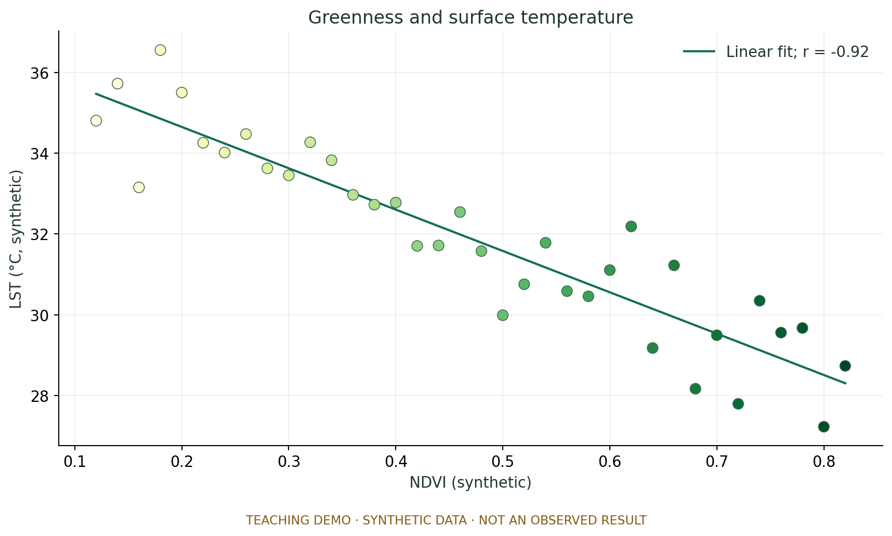
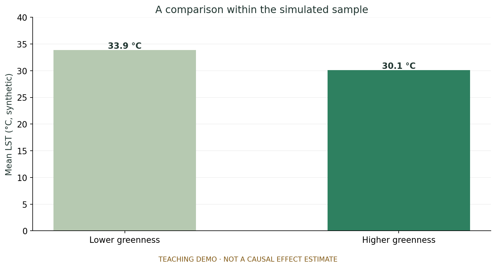

> **이 보고서는 작성 방법을 보여주는 예시입니다.** 36개의 가상 표본에 음의 관계를 의도적으로 넣었습니다. 실제 부산의 온도나 Landsat 관측 결과로 해석하면 안 됩니다. 본문의 문장 구조를 참고하고, 자기 조의 실제 자료와 결과로 교체하세요.

## 01 연구 질문 {#question}

도시의 녹지는 지표면 온도와 어떤 관계가 있을까요? 이 프로젝트는 **“녹지 지표가 높은 표본에서 지표면 온도가 낮게 나타나는가?”**를 질문으로 삼습니다.

실제 연구라면 대상 지역과 관측 시기를 정하고 NDVI와 LST를 같은 공간·시간 기준으로 비교해야 합니다. 여기서는 분석 결과를 웹보고서에 연결하는 방법에 집중하기 위해 **합성 NDVI와 합성 LST**를 사용합니다.

- **설명 변수:** 합성 NDVI, 0.12–0.82
- **결과 변수:** 합성 LST, 단위 °C
- **표본 단위:** 위치와 관측 날짜가 없는 가상의 관측점 36개
- **검토할 관계:** 두 변수의 산점도와 집단별 평균 차이

## 02 자료와 방법 {#method}

### 자료를 만든 방법

고정 난수 seed `2026`을 사용해 다음 식으로 자료를 만들었습니다.

```text
합성 LST = 37 − 11 × 합성 NDVI + 무작위 오차
```

따라서 음의 관계는 **실제 자료에서 새로 발견한 현상이 아니라 생성 과정에 넣은 조건**입니다. 이 점을 숨기지 않는 것이 예시 보고서의 가장 중요한 전제입니다.

### 분석 순서

1. 36개 가상 표본을 만들고 CSV로 저장합니다.
2. 산점도와 선형 적합선을 그립니다. Pearson 상관계수는 표본의 관계를 요약하는 값으로 사용합니다.
3. NDVI 0.45를 기준으로 두 집단을 나누어 평균 LST를 비교합니다. 0.45는 설명을 위한 임의 기준이며 보편적인 녹지 분류 기준이 아닙니다.
4. 같은 실행에서 만든 그림·수치·코드를 보고서에 연결합니다.

실제 Landsat 분석에서는 자료 ID, 지역, 기간, 구름·수면 제외 조건, 밴드 변환, 표본 추출·집계 방법을 이 절에 기록해야 합니다. 참고용 GEE 노트북은 한 장면의 LST 지도까지 다루며, 이 합성 결과를 실제 관측으로 검증한 것은 아닙니다.

## 03 분석 결과 {#results}

### 결과 1 · 두 변수의 관계를 먼저 보기



**그림 1. 합성 NDVI와 합성 LST.** 가상 표본 36개의 분포와 선형 적합선을 나타냈습니다. x축은 합성 NDVI, y축은 합성 LST(°C)입니다.

**관찰한 사실.** 표본에서 NDVI가 커질수록 LST가 낮아지는 경향이 나타났습니다. Pearson 상관계수는 **r = -0.92**입니다.

**해석.** 이 음의 관계는 생성식에 넣은 방향과 일치합니다. 산점도와 요약 통계가 같은 자료를 설명하는지 확인하는 연습으로 사용할 수 있습니다.

**주의할 점.** 이 값으로 “부산에 녹지를 늘리면 온도가 얼마나 내려간다”고 주장할 수 없습니다. 실제 관측도 아니며 인과 효과를 추정한 분석도 아닙니다.

[그림 생성 코드]({{ site.github.repository_url }}/blob/main/01_공통코드/make_demo.py) · [분석 노트북]({{ site.github.repository_url }}/blob/main/02_개인분석/01_demo_analysis.ipynb)

### 결과 2 · 집단을 나누어 비교하기



**그림 2. 가상 표본의 집단별 평균.** NDVI가 0.45 미만인 집단의 평균은 **33.9°C**, 0.45 이상인 집단은 **30.1°C**입니다. 표본 내 차이는 약 **3.7°C**입니다.

**해석.** 이 합성 표본에서는 두 집단의 평균 차이가 산점도의 방향과 일치합니다. 다만 나누는 기준을 바꾸면 각 집단의 구성과 평균도 달라질 수 있습니다.

**한계.** 막대의 차이는 표본의 기술통계입니다. 모집단의 차이나 통계적 유의성을 검증한 결과가 아니며, 실제 지역의 냉각 효과를 뜻하지 않습니다.

[표본 CSV]({{ site.github.repository_url }}/blob/main/03_분석결과/synthetic_samples.csv) · [계산 수치]({{ site.github.repository_url }}/blob/main/03_분석결과/summary.json)

## 04 논의와 한계 {#discussion}

이 예시에서 확인한 것은 **설정한 관계가 분석과 그림에 일관되게 나타났다는 사실**입니다. 현실의 도시 환경에 대한 새로운 결론은 아닙니다.

실제 프로젝트로 확장할 때는 다음을 검토해야 합니다.

- **공간·시간 일치:** NDVI와 LST가 같은 시점과 같은 공간 단위를 비교하는가?
- **관측 편향:** 구름을 제거하고 남은 날짜와 위치가 전체 지역·계절을 대표하는가?
- **표본 독립성:** 가까운 픽셀을 독립 표본처럼 취급하지 않았는가?
- **다른 설명 변수:** 고도, 해안 거리, 토지피복 등이 관계에 영향을 주지 않는가?
- **온도의 의미:** 위성의 지표면 온도를 기온이나 하루 평균 온도로 해석하지 않았는가?

각 조는 자기 자료에 해당하는 한계를 골라 **결과에 어떤 영향을 줄 수 있는지** 설명해야 합니다.

## 05 결론 {#conclusion}

합성자료 36개에서는 높은 NDVI와 낮은 LST가 함께 나타났습니다. 이는 의도한 생성식과 일치하며, 실제 녹지의 냉각 효과를 입증하지는 않습니다.

이 보고서는 **질문 → 자료와 방법 → 그림과 수치 → 해석과 한계 → 코드**를 연결하는 예시입니다. 학생 프로젝트에서는 이 연결을 유지하면서 실제 근거로 연구 질문에 답하면 됩니다.

## 06 재현과 기여 {#reproduce}

### 직접 실행하기

[Colab에서 합성자료 노트북 열기](https://colab.research.google.com/github/{{ site.github.owner_name }}/{{ site.github.repository_name }}/blob/main/02_개인분석/01_demo_analysis.ipynb)

이 노트북은 EE 인증 없이 실행됩니다. GitHub 저장소의 코드를 로컬에서 실행하려면 다음을 사용합니다.

```text
python -m pip install -r requirements.txt
python 01_공통코드/make_demo.py
```

예시 합성 분석은 2026-10-26 로컬 환경에서 실행 확인했습니다. GEE 시작 노트북의 실제 서버 실행은 검증하지 않았습니다.

[별도 연습: GEE 시작 노트북](https://colab.research.google.com/github/{{ site.github.owner_name }}/{{ site.github.repository_name }}/blob/main/01_공통코드/01_gee_starter.ipynb)

### 조원별 기여를 쓰는 방법

실제 조에서는 “조원 A: 공통 전처리 및 품질 점검 / 조원 B: 공간 비교 / 조원 C: 시계열 분석”처럼 **분석 내용과 연결된 기여**를 기록하세요. 위 역할은 작성 예시이며 실제 참여자 명단이 아닙니다. 별도 주간 보고서는 만들지 않아도 됩니다.

### 자료와 참고

- 합성자료: 이 저장소의 생성 코드, seed 2026. 외부 관측 데이터 사용 없음.
- [Landsat 8 Collection 2 Level-2 공식 자료 설명](https://developers.google.com/earth-engine/datasets/catalog/LANDSAT_LC08_C02_T1_L2)
- [학생 사용 안내]({{ site.github.repository_url }}/blob/main/STUDENT_GUIDE.md)
- [빈 보고서 틀](report-template.html)
