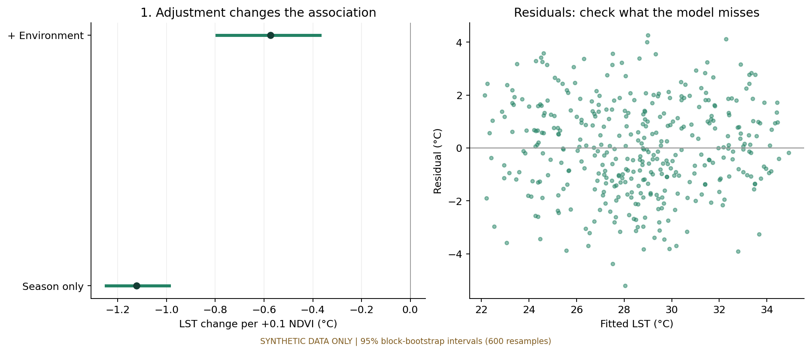
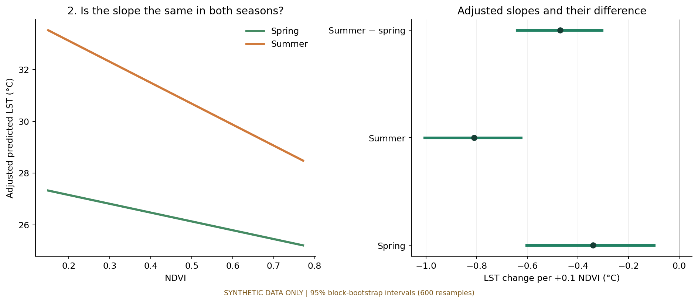
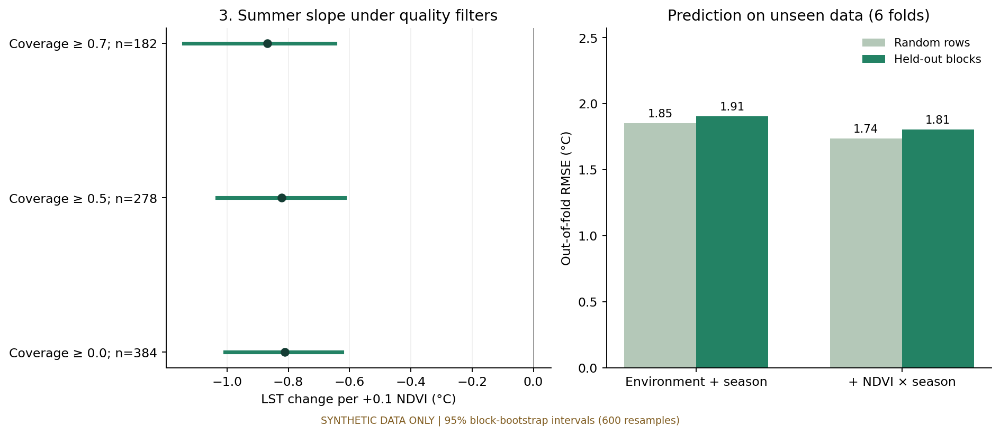

> **교육용 합성자료에 기반한 학술 보고서 예시.** 본문은 실제 도시·Landsat 관측 결과를 제시하지 않는다. 기본 탐색용 36개 표본과 세부목적 분석용 384행은 서로 다른 합성자료이다. 연구 질문을 학술적 목적으로 구체화하는 과정을 보여주기 위해 일상적 질문과 정식 목적 진술을 함께 제시하였다.

### 초록 {#abstract}

본 연구의 목적은 합성자료에서 녹지 지표와 지표면 온도의 관계가 환경조건 보정 및 계절 구분에 따라 어떻게 달라지는지 추정하고, 추정 결과의 품질 기준 민감도와 미관측 공간 블록에 대한 예측 성능을 평가하는 데 있다. 기본 탐색에는 36개 가상 표본을, 세부목적 분석에는 24개 블록에 속한 192지점의 두 계절 자료 384행을 사용하였다. 환경조건 보정 회귀, NDVI와 계절의 교호작용, 600회 블록 bootstrap 및 6-fold 블록 교차검증을 적용하였다. NDVI 0.1 증가당 계수는 계절만 보정한 모형에서 −1.12°C, 환경조건까지 보정한 모형에서 −0.57°C였다. 계절별 계수는 봄 −0.34°C, 여름 −0.81°C로 나타났다. 세 품질 기준에서 여름 계수의 음의 방향은 유지되었으며, NDVI 및 계절 교호작용을 추가했을 때 블록 교차검증 RMSE는 1.91°C에서 1.81°C로 감소하였다. 이 결과는 설정된 자료 생성 구조 아래에서 조건부 연관성, 계절별 차이, 예측 성능을 구분하여 평가할 필요성을 예시한다. 실제 녹지의 냉각 효과나 타 지역에 대한 적용 가능성을 입증하는 실증 근거는 아니다.

**주제어:** NDVI, 지표면 온도, 환경조건 보정, 계절 교호작용, 공간 블록 교차검증, 합성자료

## 01 서론 및 연구목적 {#question}

### 1.1 분석 문제와 연구 범위

녹지 지표와 지표면 온도 사이의 관계를 해석하려면 관계의 방향뿐 아니라 그 추정값이 어떤 조건에 의존하는지를 명시해야 한다. 산점도와 집단 평균은 표본의 분포를 기술하지만, 환경조건이 함께 변하는 경우의 조건부 연관성, 계절에 따른 관계의 차이, 새로운 공간 단위에 대한 예측 성능까지 설명하지는 못한다. 따라서 기술적 비교에서 도출한 해석을 확장하려면 이 세 문제를 별도로 평가하는 분석 설계가 필요하다.

본 예시는 이를 **분석 설계의 문제**로 다룬다. 선행연구 전체의 미해결 공백을 확인한 문헌 검토나 실제 도시의 열환경에 대한 실증 연구를 수행한 것은 아니다. 녹지와 관련 환경변수 및 계절 차이가 포함된 합성자료를 이용하여, 연구목적과 분석 방법 및 해석 범위를 연결하는 절차를 제시한다. 종속변수는 지표면 온도(LST), 주요 설명변수는 정규화 식생지수(NDVI)로 정의한다.

### 1.2 전체 연구목적

**본 연구는 합성자료에서 NDVI–LST 관계의 조건부 연관성과 계절별 이질성을 정량화하고, 자료 품질 기준에 대한 추정의 민감도 및 미관측 공간 블록에서의 예측 성능을 평가하는 것을 목적으로 한다.** 여기서 이질성은 계절에 따라 관계의 기울기가 달라지는 정도를 의미한다. 분석의 추론 대상은 설정된 합성자료와 모형이며, 녹지 조성이라는 개입의 인과효과는 포함하지 않는다.

이 목적을 달성하기 위해 세부목적을 순차적으로 구성하였다. 먼저 환경변수와 함께 나타나는 관계를 검토하여 단순한 연관성의 해석 범위를 좁힌다(세부목적 1). 다음으로 하나의 공통 기울기가 계절별 차이를 가리는지 평가한다(세부목적 2). 마지막으로 추정 결과가 표본 선택 조건에 얼마나 민감한지, 그리고 그 관계가 새로운 공간 집단의 예측에 얼마나 기여하는지 확인한다(세부목적 3). 세 목적은 각각 **조건부 관계의 추정 → 관계의 이질성 평가 → 결과의 안정성과 예측 성능 평가**에 대응한다.

### 1.3 일상적 질문에서 세부목적으로의 구체화 {#objectives}

일상적 질문은 연구의 출발점이다. 이를 학술적 목적으로 전환할 때에는 비교 대상, 고려할 조건, 추정할 양과 평가 방법을 명시한다. 아래의 질문은 읽기 쉬운 표현을 유지하고, 목적 진술은 분석으로 답할 수 있는 범위로 한정하였다.

#### 세부목적 1 · 환경조건 보정에 따른 NDVI–LST 연관성의 변화 정량화

> **일상적 질문:** “녹지가 많은 곳이 더 시원한 건, 고도가 높거나 포장된 면적이 적어서 그런 것 아닐까?”

**학술적 연구 질문.** 계절만 고려한 NDVI–LST 연관성은 고도·불투수면 비율·해안 거리를 추가로 보정한 이후 어느 정도 변화하는가?

**세부목적 진술.** 계절 보정 모형과 환경조건 추가 보정 모형의 NDVI 회귀계수를 비교하여, 환경조건 보정에 따른 조건부 연관성의 크기와 불확실성을 정량화한다.

**필요성 및 평가 지표.** 합성자료의 생성 과정에서 NDVI와 환경변수가 함께 변하므로, 계절만 보정한 계수를 녹지의 고유한 영향으로 해석할 수 없다. NDVI 0.1 증가당 계수와 블록 bootstrap 구간을 비교하여 다음 단계의 계절별 분석에 사용할 기준 모형을 설정한다.

#### 세부목적 2 · NDVI–LST 연관성의 계절별 이질성 평가

> **일상적 질문:** “녹지와 온도의 관계가 봄에도, 여름에도 똑같을까?”

**학술적 연구 질문.** 환경조건을 보정한 NDVI–LST 기울기는 봄과 여름 사이에 차이가 있는가?

**세부목적 진술.** NDVI와 계절의 교호작용을 포함한 모형으로 봄·여름의 조건부 기울기와 두 기울기의 차이를 추정하여 계절별 이질성을 평가한다.

**필요성 및 평가 지표.** 세부목적 1의 공통 기울기 모형은 계절 간 동일한 관계를 가정한다. 이 가정을 재검토하지 않으면 전체 평균 관계가 계절별 특성을 가릴 수 있다. 봄·여름의 기울기 및 여름−봄 차이의 구간을 평가하고, 계절을 구분한 추정값을 후속 민감도 분석의 대상으로 삼는다.

#### 세부목적 3 · 품질 기준 민감도 및 미관측 공간 블록의 예측 성능 평가

> **일상적 질문:** “자료를 더 엄격하게 골라도 결과가 같을까? 다른 지역에서도 온도를 잘 맞힐까?”

**학술적 연구 질문.** 계절별 추정치는 유효 관측 비율 기준에 얼마나 민감하며, NDVI와 계절 교호작용의 추가는 학습에 포함되지 않은 공간 블록의 예측 오차를 얼마나 감소시키는가?

**세부목적 진술.** 복수의 품질 기준에서 계절별 계수와 불확실성을 비교하고, 동일한 공간 블록 분할을 이용한 기준 모형과 확장 모형의 교차검증으로 NDVI의 추가 예측 기여를 평가한다.

**필요성 및 평가 지표.** 동일 표본에서 추정한 관계만으로는 자료 선택에 대한 민감도와 표본 밖 예측 성능을 판단할 수 없다. 품질 기준별 표본 수·기울기·추정 구간과 블록 교차검증 RMSE를 함께 제시하여, 관계 추정의 안정성과 예측상의 유용성을 구분한다.

## 02 자료 및 연구방법 {#method}

### 2.1 자료 구성 및 생성 조건 {#advanced-data}

기본 탐색 자료는 seed `2026`으로 생성한 36개 가상 표본이다. NDVI 범위는 0.12–0.82이며, `LST = 37 − 11×NDVI + 무작위 오차`의 생성식을 적용하였다. 산점도와 Pearson 상관계수로 관계를 기술하고, NDVI 0.45 미만·이상 집단의 평균 LST를 비교하였다. 0.45는 교육용 임의 기준이다.

세부목적 1–3에는 seed `20261026`으로 생성한 **별도의 384행 합성자료**를 공통으로 사용하였다. 자료는 24개 가상 블록, 블록당 8지점, 지점당 봄·여름 두 관측으로 구성된다. 따라서 고유 지점 수는 192개이며, 384행을 독립적인 384지점으로 해석하지 않는다. 기본 탐색 자료와 세부목적 분석 자료는 생성 과정이 다르므로 두 자료에서 얻은 계수를 직접 비교하지 않는다.

입력 변수는 `block`(공간 집단 번호), `site`(지점 번호), `summer`(봄=0, 여름=1), `ndvi`, `elevation_m`(고도, m), `impervious`(불투수면 비율, 0–1), `coast_km`(해안 거리, km), `valid_fraction`(가상 유효 관측 비율, 0–1), `lst_c`(LST, °C)이다. 실제 좌표나 관측 날짜는 없다.

```text
LST = 28 + 7×summer − (4+5×summer)×NDVI
      − 0.006×고도 + 3×불투수면비율 − 0.12×해안거리
      + 블록오차 + 관측오차
```

NDVI가 높을수록 고도가 높고 불투수면 비율이 낮아지는 경향을 생성 과정에 포함하였다. 같은 블록의 관측에는 공통 오차를 부여하고, 유효 관측 비율이 낮을수록 관측 오차가 커지도록 설정하였다. 생성식의 모든 계수는 교육 목적의 가정이며 외부 문헌에서 추정한 값이 아니다. 따라서 관계의 방향과 계절 차이는 분석 이전에 자료 생성 구조에 포함되어 있다.

[기본 자료 CSV]({{ site.github.repository_url }}/blob/main/03_분석결과/synthetic_samples.csv) · [세부목적 분석 CSV]({{ site.github.repository_url }}/blob/main/03_분석결과/advanced_synthetic_samples.csv) · [공통 분석 코드]({{ site.github.repository_url }}/blob/main/01_공통코드/advanced_analysis.py)

### 2.2 세부목적 1의 분석: 단계적 환경조건 보정

최소제곱법으로 모형 A와 B를 적합하였다. 모형 A는 계절과 NDVI를, 모형 B는 여기에 고도·불투수면 비율·해안 거리를 포함한다. 두 모형은 계절 사이에 동일한 NDVI 기울기를 가정한다. 비교 지표는 NDVI 0.1 증가당 LST 계수(°C)이며, 모형 B의 적합값–잔차 관계를 함께 제시하였다. 잔차 그림은 누락된 구조를 탐색하는 진단 자료로 사용하며 모형의 타당성을 단독으로 확정하는 검정으로 해석하지 않는다.

```text
모형 A: LST ~ NDVI + 계절
모형 B: LST ~ NDVI + 계절 + 고도 + 불투수면비율 + 해안거리
```

### 2.3 세부목적 2의 분석: 계절 교호작용

공통 기울기 가정을 평가하기 위해 모형 B에 `NDVI × summer`를 추가한 모형 C를 적합하였다. 봄 기울기는 NDVI 계수, 여름 기울기는 NDVI 계수와 교호작용 계수의 합으로 산출하였다. 여름−봄 기울기 차이는 교호작용 계수에 해당한다. 계절별 예측선은 고도·불투수면 비율·해안 거리를 전체 표본 평균에 고정하고 두 계절의 NDVI 범위가 겹치는 구간에서 계산하였다.

```text
모형 C: LST ~ NDVI + 계절 + NDVI×계절 + 고도 + 불투수면비율 + 해안거리
봄 기울기 = β_NDVI
여름 기울기 = β_NDVI + β_NDVI×여름
```

### 2.4 세부목적 3의 분석: 민감도 및 공간 블록 교차검증

자료 선택의 민감도는 유효 관측 비율 필터 없음, 0.5 이상, 0.7 이상 조건에서 모형 C를 반복 적합하여 평가하였다. 각 조건의 표본 수, 계절별 기울기 및 구간을 비교하였다. 두 임계값은 예시 조건이며 Landsat의 공식 권장 기준이 아니다.

예측 성능은 품질 필터 적용 전 384행을 대상으로 평가하였다. 24개 블록을 6개 fold로 분할하고 매회 20개 블록으로 학습한 뒤 나머지 4개 블록을 예측하였다. 같은 지점의 두 계절은 동일 fold에 포함된다. 모든 행의 평가 오차를 합쳐 RMSE를 산출하였으며, 계절·고도·불투수면 비율·해안 거리를 포함한 기준 모형과 여기에 NDVI 및 NDVI×계절을 추가한 확장 모형 C를 동일 분할에서 비교하였다.

임의 행 분할 결과는 평가 설계의 영향을 비교하는 보조 지표로 산출하였다. 이 경우 같은 공간 집단의 관측이 학습·평가에 함께 포함될 수 있으므로 새 공간 블록에 대한 성능 추정치로 사용하지 않았다. 그룹 단위 분할의 취지는 [공식 교차검증 문서](https://scikit-learn.org/stable/modules/cross_validation.html#cross-validation-iterators-for-grouped-data)를 참고할 수 있으며, 본 구현은 NumPy를 사용한다.

### 2.5 불확실성 및 재현성

회귀계수의 불확실성은 24개 블록을 복원추출하는 bootstrap 600회로 평가하였다. 선택된 블록의 모든 지점·계절을 함께 포함하여 재적합하고, 추정 분포의 2.5·97.5 백분위수를 95% 구간으로 제시하였다. 계절 차이는 각 반복 내에서 계산하였다. 이는 블록 사이의 독립성과 현재 표본·모형을 전제로 한 근사 구간이며 인과효과의 불확실성을 추정한 것이 아니다. 이 구간을 교차검증 RMSE의 신뢰구간으로 사용하지 않았다.

자료 생성·계산 수치·그림은 저장소의 코드와 연결하였다. 실제 Landsat 분석으로 전환할 경우에는 자료 ID, 분석 지역·기간, 밴드 변환, 구름·수면 처리, 표본 단위 및 집계 기준을 별도로 명시해야 한다. 제공된 GEE 시작 노트북은 별도 실습이며 본 합성자료를 실제 관측으로 검증한 분석은 아니다.

## 03 연구결과 {#results}

### 3.1 기초 탐색: NDVI–LST 분포 및 집단 평균


**그림 1.** 기본 합성자료의 NDVI–LST 관계. x축은 NDVI, y축은 LST(°C)이며 모든 점은 가상 표본이다.

36개 표본의 Pearson 상관계수는 **r = −0.92**로 나타났다. 이는 생성식에 설정된 음의 관계와 일치한다.


**그림 2.** 기본 합성자료의 집단별 평균 LST. NDVI 0.45 미만 집단은 **33.9°C**, 0.45 이상 집단은 **30.1°C**였으며 평균 차이는 약 **3.7°C**였다. 이 비교는 표본 내 기술통계이며 모집단 차이의 검정 결과가 아니다.

[기초 탐색 노트북]({{ site.github.repository_url }}/blob/main/02_개인분석/01_demo_analysis.ipynb) · [그림 생성 코드]({{ site.github.repository_url }}/blob/main/01_공통코드/make_demo.py) · [계산 수치]({{ site.github.repository_url }}/blob/main/03_분석결과/summary.json)

### 3.2 세부목적 1 · 환경조건 보정에 따른 연관성 변화 {#deep-confounding}

**대응 연구 질문:** 다른 환경조건을 고려한 이후에도 NDVI–LST의 음의 연관성이 유지되는가?



**그림 3.** 왼쪽은 NDVI 0.1 증가당 계수와 블록 bootstrap 95% 구간, 오른쪽은 모형 B의 적합값과 잔차(관측값−적합값)이다.

계절만 보정한 모형 A의 계수는 **−1.12°C**(95% 구간 −1.25~−0.99°C), 환경조건을 추가한 모형 B의 계수는 **−0.57°C**(−0.79~−0.37°C)였다. 보정 후 계수의 절대 크기는 감소하였으나 음의 방향은 유지되었다. 두 구간 모두 0을 포함하지 않았다. 이 결과는 설정된 모형과 합성 표본에서의 조건부 연관성을 나타내며 환경조건 보정 자체가 인과효과의 식별을 의미하지는 않는다.

[세부목적 1 노트북]({{ site.github.repository_url }}/blob/main/02_개인분석/02_confounding.ipynb)

### 3.3 세부목적 2 · 계절별 연관성의 이질성 {#deep-seasonality}

**대응 연구 질문:** 환경조건을 보정한 NDVI–LST 기울기는 봄과 여름 사이에 차이가 있는가?



**그림 4.** 왼쪽은 다른 환경변수를 전체 표본 평균으로 고정한 계절별 예측선이며 개별 지점의 관측값이 아니다. 오른쪽은 NDVI 0.1 증가당 봄·여름 기울기 및 여름−봄 차이와 블록 bootstrap 95% 구간이다.

모형 C의 봄 기울기는 **−0.34°C**(95% 구간 −0.60~−0.10°C), 여름 기울기는 **−0.81°C**(−1.01~−0.63°C)였다. 여름−봄 차이는 **−0.47°C**(−0.64~−0.31°C)로, 여름의 음의 기울기가 더 크게 나타났다. 차이의 구간이 0을 포함하지 않는다는 결과는 현재 모형과 합성 표본에서 계절별 기울기를 구분할 근거를 제공한다. 이는 생성식에 포함된 계절 차이의 추정 결과이다.

[세부목적 2 노트북]({{ site.github.repository_url }}/blob/main/02_개인분석/03_seasonality.ipynb)

### 3.4 세부목적 3 · 품질 기준 민감도 및 공간 예측 성능 {#deep-robustness}

**대응 연구 질문:** 품질 기준을 변경해도 계절별 추정이 유지되는가? NDVI의 추가가 학습에 포함되지 않은 공간 블록의 예측에 기여하는가?



**그림 5.** 왼쪽은 품질 기준별 여름 기울기와 블록 bootstrap 95% 구간이다. 오른쪽은 임의 행 분할 및 블록 분할에서 기준 모형과 확장 모형의 RMSE를 비교한다. RMSE 막대에는 신뢰구간을 표시하지 않았다.

필터 없음, 유효 관측 비율 0.5 이상, 0.7 이상에서 표본 수는 각각 **384, 278, 182행**이었다. 여름 기울기는 **−0.81, −0.82, −0.87°C/NDVI 0.1**이었으며, 95% 구간은 각각 **−1.01~−0.63, −1.03~−0.62, −1.14~−0.65°C**였다. 모든 조건에서 24개 블록이 유지되었고, 여름 계수의 방향과 0을 포함하지 않는 구간이 유지되었다. 가장 엄격한 기준의 구간은 필터를 적용하지 않은 경우보다 넓었다. 봄 기울기와 계절 차이를 포함한 전체 결과는 계산 파일에 제시하였다.

블록 교차검증 RMSE는 기준 모형 **1.91°C**, 확장 모형 **1.81°C**로, NDVI와 계절 교호작용 추가에 따른 감소량은 약 **0.10°C**였다. 확장 모형의 임의 행 분할 RMSE는 **1.74°C**로 블록 분할보다 낮았다. 이 비교는 품질 필터 적용 전 384행에서 수행하였다. 성능 차이의 유의성 검정은 수행하지 않았다.

[세부목적 3 노트북]({{ site.github.repository_url }}/blob/main/02_개인분석/04_robustness.ipynb) · [전체 추정값·구간·fold별 오차 및 배정]({{ site.github.repository_url }}/blob/main/03_분석결과/advanced_summary.json)

## 04 토의 {#discussion}

### 4.1 환경조건 보정과 계절 구분의 해석적 의미

세부목적 1에서 환경조건 보정 후 NDVI 계수의 절대 크기가 감소한 결과는, 같은 자료에서도 고려하는 조건에 따라 관계의 추정치가 달라질 수 있음을 보여준다. 본 생성 과정은 NDVI와 고도·불투수면 비율 사이의 관련성을 의도적으로 포함하므로, 이 변화는 환경조건과 함께 나타나는 관계를 검토해야 한다는 설계 취지와 부합한다. 다만 계수의 감소량을 고도 또는 불투수면이 각각 설명하는 인과적 기여율로 해석할 수는 없다. 또한 모형 B는 계절별 동일 기울기를 가정하므로 그 계수는 이 가정 아래의 공통 연관성이다.

세부목적 2는 공통 기울기만으로 요약할 때 소실될 수 있는 계절별 차이를 제시한다. 봄과 여름의 기울기를 구분한 결과는 단일 관계의 크기를 정교화하는 것뿐 아니라, 추정값의 적용 조건을 명시한다는 의미를 갖는다. 그러나 본 자료에서 계절 차이는 이미 생성식에 부여되어 있다. 따라서 이를 녹지의 실제 계절별 냉각 기작을 발견한 결과로 해석할 수 없으며, 관측자료에서 같은 패턴이 나타나더라도 그 기작을 논하려면 추가 근거가 필요하다.

### 4.2 추정의 안정성과 예측 기여의 구분

세부목적 3에서 품질 기준 변경 후에도 여름 계수의 음의 방향이 유지된 결과는 검토한 세 기준 내에서의 방향 안정성을 보여준다. 반면 표본 수 감소와 함께 구간이 넓어진 결과는 엄격한 자료 선택이 곧 추정 정밀도의 향상을 의미하지 않음을 나타낸다. 본 자료의 품질 변수는 인위적으로 생성되었으므로, 실제 결측이 특정 지역·날짜·계절에 집중되는 상황에서의 선택 편향까지 검증한 것은 아니다.

블록 교차검증에서 확장 모형의 RMSE 감소는 약 0.10°C였다. 이 차이의 실용적 중요성은 사용 목적과 허용 오차를 함께 고려하여 판단해야 하며, 현재 예시만으로 충분한 개선이라고 규정할 수 없다. 계수 구간이 0을 포함하지 않는다는 근거는 특정 모형의 연관성에 관한 것이고, RMSE 감소는 보지 않은 표본의 예측 오차에 관한 것이다. 두 지표를 함께 제시함으로써 관계의 존재와 예측상의 유용성을 구별할 수 있다.

임의 행 분할의 오차가 블록 분할보다 낮았다는 결과는 평가 단위에 따라 성능 추정이 달라질 수 있음을 보여준다. 다만 이 차이는 단일 분할 실험에서 얻은 값이며, 그 차이를 일반적인 편향의 크기로 단정하지 않는다. 본 분석은 좌표가 없는 블록을 사용하므로 실제 공간 자기상관의 거리 또는 타 도시 적용 성능을 평가한 것도 아니다.

### 4.3 한계 및 후속 연구 설계

첫째, 본 연구는 단일 생성식과 고정 seed에서 얻은 합성자료 분석이다. 추정 구간과 교차검증 결과를 실제 도시의 모집단 특성으로 일반화할 수 없으며, 여러 생성 조건에서 방법의 성능을 비교한 포괄적 시뮬레이션 연구도 아니다. 후속 검토에서는 오차 크기·변수 간 관련성·블록 수·결측 구조를 달리하여 결과의 의존성을 평가할 수 있다.

둘째, 선형회귀는 지정된 함수 형태와 포함 변수에 의존한다. 비선형 관계, 누락된 환경요인 및 변수 측정오차는 추정에 영향을 줄 수 있다. 블록 bootstrap 역시 블록 간 독립성을 전제로 하며 24개 블록과 600회 재표집에서 얻은 구간의 정밀도에는 제약이 있다. 계절별 구간의 분리만으로 생태·물리적 기작을 확정하지 않는다.

셋째, 두 계절과 단일 6-fold 분할은 연중 변화·장기 추세·미래 연도 예측을 평가하기에 충분하지 않다. 실제 위성자료 연구로 확장할 때에는 NDVI와 LST의 공간·시간 대응, 구름 및 수면 처리, 계절별 관측일과 표본 대표성을 확인하고 목적에 맞는 공간·시간 분할을 설계해야 한다. 지표면 온도에 관한 결과를 기온이나 일평균 온도에 대한 결론으로 대체해서도 안 된다.

마지막으로 본 예시의 학술적 기능은 연구 질문과 분석·해석 범위의 대응을 시연하는 데 있다. 실증적 신규성이나 선행연구 대비 우수성을 주장하지 않는다. 실제 보고서에서는 관련 일차 문헌을 검토하여 연구 공백을 설정하고, 결과의 일치·차이를 대상 지역·기간·표본 단위·방법 차이와 연결해 논의해야 한다.

## 05 결론 {#conclusion}

본 연구는 합성자료를 이용하여 NDVI–LST 관계를 환경조건 보정, 계절별 이질성, 자료 선택 민감도 및 공간 예측 성능의 측면에서 평가하였다. 세부목적별 결론은 다음과 같다.

1. **세부목적 1 — 조건부 연관성.** NDVI 0.1 증가당 계수는 계절만 보정했을 때 −1.12°C, 환경조건을 추가했을 때 −0.57°C였다. 이 결과는 관계의 크기를 제시할 때 보정 조건을 명시해야 함을 보여주며, 녹지의 인과적 냉각 효과를 추정한 결과는 아니다.
2. **세부목적 2 — 계절별 이질성.** 봄과 여름의 기울기는 각각 −0.34°C와 −0.81°C였고, 여름−봄 차이는 −0.47°C(95% 구간 −0.64~−0.31°C)였다. 설정된 생성 구조와 모형 아래에서 하나의 공통 기울기만으로는 계절 차이를 충분히 나타내지 못하였다.
3. **세부목적 3 — 민감도와 예측 성능.** 세 품질 기준에서 여름 계수의 방향은 유지되었으나, 가장 엄격한 조건에서는 표본 수가 줄고 구간이 넓어졌다. NDVI와 교호작용 추가에 따른 블록 교차검증 RMSE 감소는 약 0.10°C였다. 관계 추정의 안정성과 예측 기여는 구분하여 판단할 필요가 있다.

이상의 결과는 연구 질문을 조건·추정량·평가 기준이 명시된 세부목적으로 구체화하고, 각 목적에 대응하는 근거와 한계를 제시하는 분석 절차를 예시한다. 실제 도시 환경에 대한 결론은 관측자료와 적절한 검증 설계에 기반한 후속 분석을 통해 별도로 도출해야 한다.

## 06 재현성 및 연구 기여 {#reproduce}

### 직접 실행하기

[Colab에서 합성자료 노트북 열기](https://colab.research.google.com/github/{{ site.github.owner_name }}/{{ site.github.repository_name }}/blob/main/02_개인분석/01_demo_analysis.ipynb)

심화 분석도 EE 인증 없이 실행됩니다. 공통 자료 준비 블록을 먼저 실행하고 해당 분석 셀을 따라가세요.

- [세부목적 1: 환경조건 보정 — Colab](https://colab.research.google.com/github/{{ site.github.owner_name }}/{{ site.github.repository_name }}/blob/main/02_개인분석/02_confounding.ipynb)
- [세부목적 2: 계절별 관계 — Colab](https://colab.research.google.com/github/{{ site.github.owner_name }}/{{ site.github.repository_name }}/blob/main/02_개인분석/03_seasonality.ipynb)
- [세부목적 3: 강건성·공간 검증 — Colab](https://colab.research.google.com/github/{{ site.github.owner_name }}/{{ site.github.repository_name }}/blob/main/02_개인분석/04_robustness.ipynb)

GitHub 저장소의 코드를 로컬에서 실행하려면 다음을 사용합니다.

```text
python -m pip install -r requirements.txt
python 01_공통코드/make_demo.py
python 01_공통코드/advanced_analysis.py
```

예시 합성 분석은 2026-10-26 로컬 환경에서 실행 확인했습니다. GEE 시작 노트북의 실제 서버 실행은 검증하지 않았습니다.

[별도 연습: GEE 시작 노트북](https://colab.research.google.com/github/{{ site.github.owner_name }}/{{ site.github.repository_name }}/blob/main/01_공통코드/01_gee_starter.ipynb)

### 조원별 기여를 쓰는 방법

실제 조에서는 “조원 A: 공통 전처리 및 품질 점검 / 조원 B: 공간 비교 / 조원 C: 시계열 분석”처럼 **분석 내용과 연결된 기여**를 기록하세요. 위 역할은 작성 예시이며 실제 참여자 명단이 아닙니다. 별도 주간 보고서는 만들지 않아도 됩니다.

### 자료와 참고

- 합성자료: 이 저장소의 생성 코드, seed 2026(기본), 20261026(심화). 외부 관측 데이터 사용 없음.
- [Landsat 8 Collection 2 Level-2 공식 자료 설명](https://developers.google.com/earth-engine/datasets/catalog/LANDSAT_LC08_C02_T1_L2)
- [학생 사용 안내]({{ site.github.repository_url }}/blob/main/STUDENT_GUIDE.md)
- [빈 보고서 틀](report-template.html)
